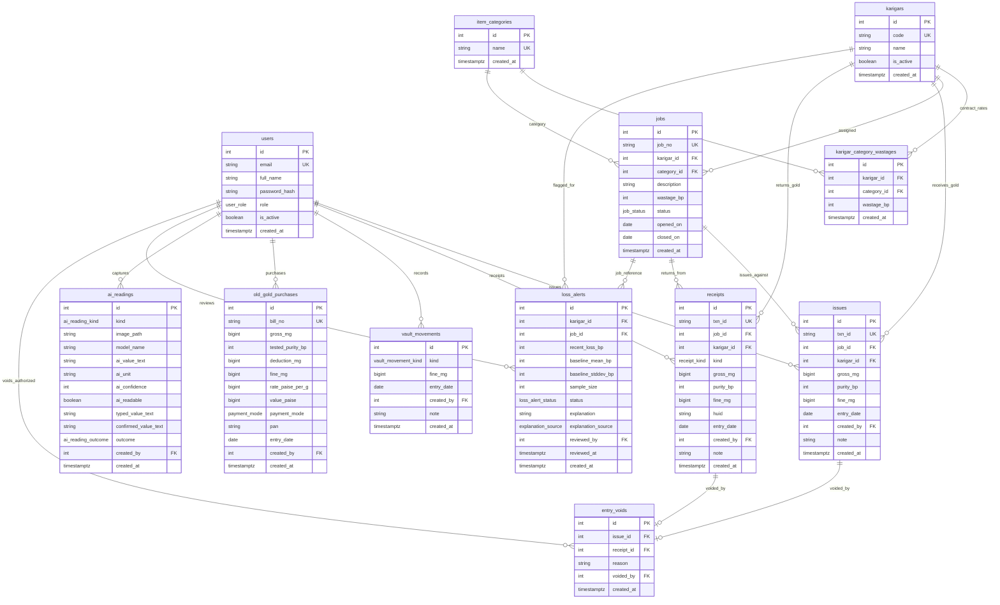

# Technical Design Document (TDD) Outline

## Architecture

## Data model

The Karigar Gold Ledger relational data model is designed around append-only ledger transaction rows with strict domain integrity constraints. All weights are stored as `BIGINT` milligrams, purities and wastages as `INTEGER` basis points, and monetary values as `BIGINT` paise.

### Table Specifications & Constraints
- **`users`**: Role-based access control (`issue_clerk`, `finance_head`).
- **`karigars`**: Artisan master with unique code (`K-001`, `K-002`, etc.).
- **`item_categories`**: Jewellery classification (`Necklace`, `Ring`, `Bangle`, etc.).
- **`karigar_category_wastages`**: Contractual agreed wastage % per artisan and category (`0 <= wastage_bp <= 10000`).
- **`jobs`**: Workshop job orders capturing immutable wastage snapshot at creation. Enforces `closed_on` is null if open, and not null if closed.
- **`issues`**: Gold issued to karigar. Enforces `gross_mg > 0`, `0 < purity_bp <= 10000`, and `0 < fine_mg <= gross_mg`.
- **`receipts`**: Finished jewellery, scrap, and filings. Enforces `(kind = 'finished') OR (huid IS NULL)` to guarantee hallmarks only exist on finished items.
- **`entry_voids`**: Append-only transaction void audit log. Enforces `length(reason) >= 5`, mutually exclusive target references (`(issue_id IS NOT NULL AND receipt_id IS NULL) OR (issue_id IS NULL AND receipt_id IS NOT NULL)`), and unique constraints per issue/receipt ensuring exactly-once voiding.
- **`vault_movements`**: Bullion deposits, refiner despatches, and refiner returns.
- **`old_gold_purchases`**: Customer scrap gold intake with purity testing, deductions, and PAN recording.
- **`loss_alerts`**: Statistical loss-drift records generated prior to month-end.
- **`ai_readings`**: Audit trail of scale and karat meter OCR readings with clerk confirmation status.

## Flows

## AI design

## UI decisions

## Assumptions

## What I cut

## Next steps
